<div align="center">



<br>


<br>

**An independent Equihash blockchain with its own wallet, explorer and mining pool.**

<br>

<a href="https://rewecoin.com/"></a> <a href="https://wallet.rewecoin.com/"></a> <a href="https://explorer.rewecoin.com/"></a> <a href="https://pool.rewecoin.com/"></a>

</div>

<br>



> [!NOTE]
> **Early-stage network:** hashrate is currently very low (around 1 Sol/s), so new miners have a real impact.



## Network status

| Component | Status |
|:---|:---:|
| Mainnet |  Live |
| Mining pool |  Active |
| Explorer |  Online |
| Wallet |  Online |
| Seed nodes |  Live |
| Worm Shield |  Live |


## Quick start


### Step 1: create your wallet and mining address

1. Open https://wallet.rewecoin.com and create (or open) your wallet.
2. Back up your recovery phrase offline. Anyone who has it can take your coins, and if you lose it you lose access.
3. Go to https://wallet.rewecoin.com/mining.html and click **Create mining address**.
4. Copy the new address from the "Mining addresses" table. Use it as your username in the miner.
5. Track found blocks, pending rewards and confirmed rewards on the same Mining page.


<div align="center">

## HOW TO MINE


</div>

<br>

| Setting | Value |
|:---|:---|
| **Server** | `178.104.208.90` |
| **Port** | `3092` (auto difficulty) or `3093` (fixed difficulty) |
| **Username** | your ReweCoin wallet address (optionally add a worker name: `ADDRESS.worker1`) |
| **Password** | `x` |
| **Algorithm** | Equihash |

**Example with nheqminer (CPU):**

```bash
nheqminer.exe -l 178.104.208.90:3093 -u YOUR_RWC_ADDRESS.worker1 -t 3
```

<details>
<summary><b>More miner examples</b> (click to expand)</summary>

<br>

**nheqminer on Linux**

```bash
./nheqminer -l 178.104.208.90:3093 -u YOUR_RWC_ADDRESS.worker1 -t 3
```

**miniZ on Windows**

```bash
miniZ.exe --url=YOUR_RWC_ADDRESS.worker1@178.104.208.90:3092 --pass=x --par=200,9 --pers=ZcashPoW
```

**miniZ on Linux**

```bash
./miniZ --url=YOUR_RWC_ADDRESS.worker1@178.104.208.90:3092 --pass=x --par=200,9 --pers=ZcashPoW
```

Replace `YOUR_RWC_ADDRESS` with the mining address you created in the wallet.

</details>


## Pool details

| Setting | Value |
|:---|:---|
| **Pool fee** | 1.5 % |
| **Payout scheme** | PPLNS |
| **Block reward** | 50 RWC |
| **Payout interval** | every 10 minutes |
| **Minimum payout** | 0.01 RWC |
| **Block maturity** | 100 confirmations |

> [!IMPORTANT]
> Rewards from a block become payable only after it has **100 confirmations**, so there is a delay between finding a block and receiving the payout.


## Join the network

We are looking for:

- GPU and CPU miners
- Node operators
- Infrastructure sponsors
- VPS partners
- Web3 developers


## Mission

Building a secure and decentralized blockchain ecosystem.

<br>

<div align="center">

[](https://rewecoin.com)
[](https://pool.rewecoin.com)

</div>


