<svg xmlns="http://www.w3.org/2000/svg" viewBox="0 0 1000 280" width="1000" height="280" role="img" aria-label="ReweCoin" xmlns:c2pa="http://c2pa.org/manifest"><metadata><c2pa:manifest>AAAWgmp1bWIAAAAeanVtZGMycGEAEQAQgAAAqgA4m3EDYzJwYQAAABZcanVtYgAAAEdqdW1kYzJtYQARABCAAACqADibcQN1cm46YzJwYTpkMGY5ODZkMi00M2MwLTQ0NzEtODM1ZC1mYWM5ZWIzY2MwYmIAAAADl2p1bWIAAAApanVtZGMyYXMAEQAQgAAAqgA4m3EDYzJwYS5hc3NlcnRpb25zAAAAALxqdW1iAAAARGp1bWRjYm9yABEAEIAAAKoAOJtxE2MycGEuaW5ncmVkaWVudC52MwAAAAAYYzJzaHmplvisbxBVL6/japBhzOgAAABwY2JvcqNpZGM6Zm9ybWF0bWltYWdlL3N2Zyt4bWxqaW5zdGFuY2VJRHgseG1wOmlpZDo3NTE0MzEyZS03MWEyLTRkNDItOTEwMS0xNTg3ZDYxMmM1MzVscmVsYXRpb25zaGlwaHBhcmVudE9mAAAB4mp1bWIAAABBanVtZGNib3IAEQAQgAAAqgA4m3ETYzJwYS5hY3Rpb25zLnYyAAAAABhjMnNoqgofOrMVVkAjOZYcEmgw4wAAAZljYm9yomdhY3Rpb25zgqJmYWN0aW9ua2MycGEub3BlbmVkanBhcmFtZXRlcnOha2luZ3JlZGllbnRzgaJjdXJseC1zZWxmI2p1bWJmPWMycGEuYXNzZXJ0aW9ucy9jMnBhLmluZ3JlZGllbnQudjNkaGFzaFggQNBhuAqfd9odHCc/oytgSbt/wbMPfm6knldcup9K3MOkZmFjdGlvbngdY29tLmFudGhyb3BpYy5jbGF1ZGUucHJvdmlkZWRqcGFyYW1ldGVyc6F4H2NvbS5hbnRocm9waWMub3JpZ2luLWNvbmZpZGVuY2VndW5rbm93bmtkZXNjcmlwdGlvbnhmQ2xhdWRlIHByb3ZpZGVkIHRoaXMgZmlsZSBhdCB0aGUgcmVxdWVzdCBvZiBhIHVzZXIgYW5kIG1heSBoYXZlIGNyZWF0ZWQgb3IgbW9kaWZpZWQgdGhlIGZpbGUgY29udGVudHMubXNvZnR3YXJlQWdlbnShZG5hbWVmQ2xhdWRlcmFsbEFjdGlvbnNJbmNsdWRlZPUAAADIanVtYgAAAEBqdW1kY2JvcgARABCAAACqADibcRNjMnBhLmhhc2guZGF0YQAAAAAYYzJzaP8tPS2UvonM6fW1pPyA5b8AAACAY2JvcqVjYWxnZnNoYTI1NmNwYWRNAAAAAAAAAAAAAAAAAGRoYXNoWCAsv49AZRnpEz1c6Jli9I2OcxHLvvgfzh2d4Ks37ZR2ImRuYW1lbmp1bWJmIG1hbmlmZXN0amV4Y2x1c2lvbnOBomVzdGFydBi5Zmxlbmd0aBkeBAAAAj5qdW1iAAAAJ2p1bWRjMmNsABEAEIAAAKoAOJtxA2MycGEuY2xhaW0udjIAAAACD2Nib3KlY2FsZ2ZzaGEyNTZpc2lnbmF0dXJleE1zZWxmI2p1bWJmPS9jMnBhL3VybjpjMnBhOmQwZjk4NmQyLTQzYzAtNDQ3MS04MzVkLWZhYzllYjNjYzBiYi9jMnBhLnNpZ25hdHVyZWppbnN0YW5jZUlEeCx4bXA6aWlkOjg2YmZjMWM5LTU4YjctNGY1ZC1iNDI2LTIyZGI0MzcxOTFkYXJjcmVhdGVkX2Fzc2VydGlvbnODomN1cmx4LXNlbGYjanVtYmY9YzJwYS5hc3NlcnRpb25zL2MycGEuaW5ncmVkaWVudC52M2RoYXNoWCBA0GG4Cp932h0cJz+jK2BJu3/Bsw9+bqSeV1y6n0rcw6JjdXJseCpzZWxmI2p1bWJmPWMycGEuYXNzZXJ0aW9ucy9jMnBhLmFjdGlvbnMudjJkaGFzaFggEdcj29YIKHF7/FMfwnI/NYaX6uRL9gqfIHKBWEAxezmiY3VybHgpc2VsZiNqdW1iZj1jMnBhLmFzc2VydGlvbnMvYzJwYS5oYXNoLmRhdGFkaGFzaFggKmZFxAoQr+wPjMxfORxGXbd1GMbCBUAd+9pLinwf1LJ0Y2xhaW1fZ2VuZXJhdG9yX2luZm+jZG5hbWVvQW50aHJvcGljIEZpbGVzZ3ZlcnNpb25lMS4wLjBrc3BlY1ZlcnNpb25lMi40LjAAABA4anVtYgAAAChqdW1kYzJjcwARABCAAACqADibcQNjMnBhLnNpZ25hdHVyZQAAABAIY2JvctKEWQISogEmGCFZAgowggIGMIIBjaADAgECAhRA5aAK7sI50L64g/oGQgU9Z1UTADAKBggqhkjOPQQDAzBJMRcwFQYDVQQKEw5BbnRocm9waWMsIFBCQzEuMCwGA1UEAxMlQW50aHJvcGljIENvbnRlbnQgQ3JlZGVudGlhbHMgUm9vdCBDQTAeFw0yNjA4MDcxODQzNTZaFw0yODA4MDYxOTQzNTZaMEQxFzAVBgNVBAoTDkFudGhyb3BpYywgUEJDMSkwJwYDVQQDEyBBbnRocm9waWMgQ2xhdWRlIENvbnRlbnQgU2lnbmluZzBZMBMGByqGSM49AgEGCCqGSM49AwEHA0IABJh6CmvLUBgFFNU0vUKlOVtE6djd17L5SuwX0LemFisBM3dkd/3cyjxFA3Qo5S46fX0/ihY0VZ7mfb9KF703t5OjWDBWMA4GA1UdDwEB/wQEAwIHgDAVBgNVHSUEDjAMBgorBgEEAYPoXgIBMAwGA1UdEwEB/wQCMAAwHwYDVR0jBBgwFoAUzlHiBIFOZFsj+OPEz5o+nMHXXMIwCgYIKoZIzj0EAwMDZwAwZAIwMXMdFJ4BetLLVY7ORuE9noqbbAZOZn/aArXyTwFAZfKrPzxF2vPoJNf1+UCdg1XGAjBwX1zd9WGqYkqmL5SFqw1QySjr1zJfpJM9+1rdDwSPLMOPOjKuiXjoU/pUUeG9RwmhY3BhZFkNngAAAAAAAAAAAAAAAAAAAAAAAAAAAAAAAAAAAAAAAAAAAAAAAAAAAAAAAAAAAAAAAAAAAAAAAAAAAAAAAAAAAAAAAAAAAAAAAAAAAAAAAAAAAAAAAAAAAAAAAAAAAAAAAAAAAAAAAAAAAAAAAAAAAAAAAAAAAAAAAAAAAAAAAAAAAAAAAAAAAAAAAAAAAAAAAAAAAAAAAAAAAAAAAAAAAAAAAAAAAAAAAAAAAAAAAAAAAAAAAAAAAAAAAAAAAAAAAAAAAAAAAAAAAAAAAAAAAAAAAAAAAAAAAAAAAAAAAAAAAAAAAAAAAAAAAAAAAAAAAAAAAAAAAAAAAAAAAAAAAAAAAAAAAAAAAAAAAAAAAAAAAAAAAAAAAAAAAAAAAAAAAAAAAAAAAAAAAAAAAAAAAAAAAAAAAAAAAAAAAAAAAAAAAAAAAAAAAAAAAAAAAAAAAAAAAAAAAAAAAAAAAAAAAAAAAAAAAAAAAAAAAAAAAAAAAAAAAAAAAAAAAAAAAAAAAAAAAAAAAAAAAAAAAAAAAAAAAAAAAAAAAAAAAAAAAAAAAAAAAAAAAAAAAAAAAAAAAAAAAAAAAAAAAAAAAAAAAAAAAAAAAAAAAAAAAAAAAAAAAAAAAAAAAAAAAAAAAAAAAAAAAAAAAAAAAAAAAAAAAAAAAAAAAAAAAAAAAAAAAAAAAAAAAAAAAAAAAAAAAAAAAAAAAAAAAAAAAAAAAAAAAAAAAAAAAAAAAAAAAAAAAAAAAAAAAAAAAAAAAAAAAAAAAAAAAAAAAAAAAAAAAAAAAAAAAAAAAAAAAAAAAAAAAAAAAAAAAAAAAAAAAAAAAAAAAAAAAAAAAAAAAAAAAAAAAAAAAAAAAAAAAAAAAAAAAAAAAAAAAAAAAAAAAAAAAAAAAAAAAAAAAAAAAAAAAAAAAAAAAAAAAAAAAAAAAAAAAAAAAAAAAAAAAAAAAAAAAAAAAAAAAAAAAAAAAAAAAAAAAAAAAAAAAAAAAAAAAAAAAAAAAAAAAAAAAAAAAAAAAAAAAAAAAAAAAAAAAAAAAAAAAAAAAAAAAAAAAAAAAAAAAAAAAAAAAAAAAAAAAAAAAAAAAAAAAAAAAAAAAAAAAAAAAAAAAAAAAAAAAAAAAAAAAAAAAAAAAAAAAAAAAAAAAAAAAAAAAAAAAAAAAAAAAAAAAAAAAAAAAAAAAAAAAAAAAAAAAAAAAAAAAAAAAAAAAAAAAAAAAAAAAAAAAAAAAAAAAAAAAAAAAAAAAAAAAAAAAAAAAAAAAAAAAAAAAAAAAAAAAAAAAAAAAAAAAAAAAAAAAAAAAAAAAAAAAAAAAAAAAAAAAAAAAAAAAAAAAAAAAAAAAAAAAAAAAAAAAAAAAAAAAAAAAAAAAAAAAAAAAAAAAAAAAAAAAAAAAAAAAAAAAAAAAAAAAAAAAAAAAAAAAAAAAAAAAAAAAAAAAAAAAAAAAAAAAAAAAAAAAAAAAAAAAAAAAAAAAAAAAAAAAAAAAAAAAAAAAAAAAAAAAAAAAAAAAAAAAAAAAAAAAAAAAAAAAAAAAAAAAAAAAAAAAAAAAAAAAAAAAAAAAAAAAAAAAAAAAAAAAAAAAAAAAAAAAAAAAAAAAAAAAAAAAAAAAAAAAAAAAAAAAAAAAAAAAAAAAAAAAAAAAAAAAAAAAAAAAAAAAAAAAAAAAAAAAAAAAAAAAAAAAAAAAAAAAAAAAAAAAAAAAAAAAAAAAAAAAAAAAAAAAAAAAAAAAAAAAAAAAAAAAAAAAAAAAAAAAAAAAAAAAAAAAAAAAAAAAAAAAAAAAAAAAAAAAAAAAAAAAAAAAAAAAAAAAAAAAAAAAAAAAAAAAAAAAAAAAAAAAAAAAAAAAAAAAAAAAAAAAAAAAAAAAAAAAAAAAAAAAAAAAAAAAAAAAAAAAAAAAAAAAAAAAAAAAAAAAAAAAAAAAAAAAAAAAAAAAAAAAAAAAAAAAAAAAAAAAAAAAAAAAAAAAAAAAAAAAAAAAAAAAAAAAAAAAAAAAAAAAAAAAAAAAAAAAAAAAAAAAAAAAAAAAAAAAAAAAAAAAAAAAAAAAAAAAAAAAAAAAAAAAAAAAAAAAAAAAAAAAAAAAAAAAAAAAAAAAAAAAAAAAAAAAAAAAAAAAAAAAAAAAAAAAAAAAAAAAAAAAAAAAAAAAAAAAAAAAAAAAAAAAAAAAAAAAAAAAAAAAAAAAAAAAAAAAAAAAAAAAAAAAAAAAAAAAAAAAAAAAAAAAAAAAAAAAAAAAAAAAAAAAAAAAAAAAAAAAAAAAAAAAAAAAAAAAAAAAAAAAAAAAAAAAAAAAAAAAAAAAAAAAAAAAAAAAAAAAAAAAAAAAAAAAAAAAAAAAAAAAAAAAAAAAAAAAAAAAAAAAAAAAAAAAAAAAAAAAAAAAAAAAAAAAAAAAAAAAAAAAAAAAAAAAAAAAAAAAAAAAAAAAAAAAAAAAAAAAAAAAAAAAAAAAAAAAAAAAAAAAAAAAAAAAAAAAAAAAAAAAAAAAAAAAAAAAAAAAAAAAAAAAAAAAAAAAAAAAAAAAAAAAAAAAAAAAAAAAAAAAAAAAAAAAAAAAAAAAAAAAAAAAAAAAAAAAAAAAAAAAAAAAAAAAAAAAAAAAAAAAAAAAAAAAAAAAAAAAAAAAAAAAAAAAAAAAAAAAAAAAAAAAAAAAAAAAAAAAAAAAAAAAAAAAAAAAAAAAAAAAAAAAAAAAAAAAAAAAAAAAAAAAAAAAAAAAAAAAAAAAAAAAAAAAAAAAAAAAAAAAAAAAAAAAAAAAAAAAAAAAAAAAAAAAAAAAAAAAAAAAAAAAAAAAAAAAAAAAAAAAAAAAAAAAAAAAAAAAAAAAAAAAAAAAAAAAAAAAAAAAAAAAAAAAAAAAAAAAAAAAAAAAAAAAAAAAAAAAAAAAAAAAAAAAAAAAAAAAAAAAAAAAAAAAAAAAAAAAAAAAAAAAAAAAAAAAAAAAAAAAAAAAAAAAAAAAAAAAAAAAAAAAAAAAAAAAAAAAAAAAAAAAAAAAAAAAAAAAAAAAAAAAAAAAAAAAAAAAAAAAAAAAAAAAAAAAAAAAAAAAAAAAAAAAAAAAAAAAAAAAAAAAAAAAAAAAAAAAAAAAAAAAAAAAAAAAAAAAAAAAAAAAAAAAAAAAAAAAAAAAAAAAAAAAAAAAAAAAAAAAAAAAAAAAAAAAAAAAAAAAAAAAAAAAAAAAAAAAAAAAAAAAAAAAAAAAAAAAAAAAAAAAAAAAAAAAAAAAAAAAAAAAAAAAAAAAAAAAAAAAAAAAAAAAAAAAAAAAAAAAAAAAAAAAAAAAAAAAAAAAAAAAAAAAAAAAAAAAAAAAAAAAAAAAAAAAAAAAAAAAAAAAAAAAAAAAAAAAAAAAAAAAAAAAAAAAAAAAAAAAAAAAAAAAAAAAAAAAAAAAAAAAAAAAAAAAAAAAAAAAAAAAAAAAAAAAAAAAAAAAAAAAAAAAAAAAAAAAAAAAAAAAAAAAAAAAAAAAAAAAAAAAAAAAAAAAAAAAAAAAAAAAAAAAAAAAAAAAAAAAAAAAAAAAAAAAAAAAAAAAAAAAAAAAAAAAAAAAAAAAAAAAAAAAAAAAAAAAAAAAAAAAAAAAAAAAAAAAAAAAAAAAAAAAAAAAAAAAAAAAAAAAAAAAAAAAAAAAAAAAAAAAAAAAAAAAAAAAAAAAAAAAAAAAAAAAAAAAAAAAAAAAAAAAAAAAAAAAAAAAAAAAAAAAAAAAAAAAAAAAAAAAAAAAAAAAAAAAAAAAAAAAAAAAAAAAAAAAAAAAAAAAAAAAAAAAAAAAAAAAAAAAAAAAAAAAAAAAAAAAAAAAAAAAAAAAAAAAAAAAAAAAAAAAAAAAAAAAAAAAAAAAAAAAAAAAAAAAAAAAAAAAAAAAAAAAAAAAAAAAAAAAAAAAAAAAAAAAAAAAAAAAAAAAAAAAAAAAAAAAAAAAAAAAAAAAAAAAAAAAAAAAAAAAAAAAAAAAAAAAAAAAAAAAAAAAAAAAAAAAAAAAAAAAAAAAAAAAAAAAAAAAAAAAAAAAAAAAAAAAAAAAAAAAAAAAAAAAAAAAAAAAAAAAAAAAAAAAAAAAAAAAAAAAAAAAAAAAAAAAAAAAAAAAAAAAAAAAAAAAAAAAAAAAAAAAAAAAAAAAAAAAAAAAAAAAAAAAAAAAAAAAAAAAAAAAAAAAAAAAAAAAAAAAAAAAAAAAAAAAAAAAAAAAAAAAAAAAAAAAAAAAAAAAAAAAAAAAAAAAAAAAAAAAAAAAAAAAAAAAAAAAAAAAAAAAAAAAAAAAAAAAAAAAAAAAAAAAAAAAAAAAAAAAAAAAAAAAAAAAAAAAAAAAAAAAAAAAAAAAAAAAAAAAAAAAAAAAAAAAAAAAAAAAAAAAAAAAAAAAAAAAAAAAAAAAAAAAAAAAAAAAAAAAAAAAAAAAAAAAAAAAAAAAAAAAAAAAAAAAAAAAAAAAAAAAAAAAAAAAAAAAAAAAAAAAAAAAAAAAAAAAAAAAAAAAAAAAAAAAAAAAAAAAAAAAAAAAAAAAAAAAAAAAAAAAAAAAAAAAAAAAAAAAAAAAAAAAAAAAAAAAAAAAAAAAAAAAAAAAAAAAAAAAAAAAAAAAAAAAAAAAAAAAAAAAAAAAAAAAAAAAAAAAAAAAAAAAAAAAAAAAAAAAAAAAAAAAAAAAAAAAAAAAAAAAAAAAAAAAAAAAAAAAPZYQEmWlPtV5LMsJom9i09bEssYLzQPjb3dm6Bgpmh9fWZE/UPO/E+N+yFTLeJekds1NGGQaGgi91sBSvX9VEo96yg=</c2pa:manifest></metadata>
  <defs>
    <linearGradient id="bg" x1="0" y1="0" x2="1" y2="1">
      <stop offset="0" stop-color="#031327"/>
      <stop offset="1" stop-color="#020a18"/>
    </linearGradient>
    <linearGradient id="title" x1="0" y1="0" x2="1" y2="0">
      <stop offset="0" stop-color="#35d0ff"/>
      <stop offset="0.55" stop-color="#d6efff"/>
      <stop offset="1" stop-color="#39ff14"/>
    </linearGradient>
    <linearGradient id="line" x1="0" y1="0" x2="1" y2="0">
      <stop offset="0" stop-color="#2a6fe0" stop-opacity="0"/>
      <stop offset="0.5" stop-color="#35d0ff"/>
      <stop offset="1" stop-color="#39ff14" stop-opacity="0"/>
    </linearGradient>
    <pattern id="grid" width="40" height="40" patternUnits="userSpaceOnUse">
      <path d="M40 0H0V40" fill="none" stroke="#35d0ff" stroke-opacity="0.07" stroke-width="1"/>
    </pattern>
    <filter id="glow" x="-20%" y="-50%" width="140%" height="200%">
      <feGaussianBlur stdDeviation="6" result="b"/>
      <feMerge><feMergeNode in="b"/><feMergeNode in="SourceGraphic"/></feMerge>
    </filter>
    <style>
      .t { font-family: Cambria, Georgia, 'Times New Roman', serif; font-weight: 700; letter-spacing: 10px; }
      .s { font-family: Consolas, 'Courier New', monospace; letter-spacing: 4px; }
      .scan { animation: scan 6s linear infinite; }
      @keyframes scan { from { transform: translateY(-20px); } to { transform: translateY(300px); } }
      .led { animation: blink 2.6s infinite; }
      @keyframes blink { 0%,86%,100% { opacity: 1; } 92% { opacity: .2; } }
      .pulse { animation: pulse 3.5s ease-in-out infinite; }
      @keyframes pulse { 0%,100% { opacity: .55; } 50% { opacity: 1; } }
      .run { stroke-dasharray: 60 940; animation: run 4s linear infinite; }
      @keyframes run { from { stroke-dashoffset: 0; } to { stroke-dashoffset: -1000; } }
      @media (prefers-reduced-motion: reduce) { .scan,.led,.pulse,.run { animation: none; } }
    </style>
  </defs>

  <rect width="1000" height="280" fill="url(#bg)"/>
  <rect width="1000" height="280" fill="url(#grid)"/>
  <rect class="scan" x="0" y="0" width="1000" height="20" fill="#35d0ff" opacity="0.05"/>

  <!-- chamfered frame -->
  <path d="M14 34 34 14H966L986 34V246L966 266H34L14 246Z" fill="none" stroke="#2a6fe0" stroke-width="2"/>
  <path d="M14 34 34 14H966L986 34V246L966 266H34L14 246Z" fill="none" stroke="#39ff14" stroke-width="2.5" class="run" filter="url(#glow)" pathLength="1000"/>

  <!-- circuit traces -->
  <g fill="none" stroke="#35d0ff" stroke-opacity="0.45" stroke-width="1.2">
    <path d="M986 70H890L868 92H780L758 114H700"/>
    <path d="M986 100H930L912 118"/>
    <path d="M14 210H110L132 188H220L242 166H300"/>
    <path d="M14 180H70L90 160"/>
  </g>
  <g fill="#041a3c" stroke="#35d0ff" stroke-width="1.2">
    <circle cx="700" cy="114" r="3.5"/><circle cx="912" cy="118" r="3"/>
    <circle cx="300" cy="166" r="3.5"/><circle cx="90" cy="160" r="3"/>
  </g>

  <!-- title -->
  <text class="t pulse" x="500" y="138" text-anchor="middle" font-size="86" fill="url(#title)" filter="url(#glow)">REWECOIN</text>
  <rect x="250" y="164" width="500" height="2" fill="url(#line)"/>
  <text class="s" x="500" y="200" text-anchor="middle" font-size="17" fill="#8db0d6">INDEPENDENT EQUIHASH BLOCKCHAIN</text>
  <text class="s" x="500" y="228" text-anchor="middle" font-size="13" fill="#39ff14" opacity="0.85">WALLET  ·  EXPLORER  ·  MINING POOL</text>

  <!-- leds -->
  <circle class="led" cx="960" cy="34" r="3.5" fill="#39ff14" filter="url(#glow)"/>
  <circle class="led" cx="946" cy="34" r="3.5" fill="#1aa0ff" filter="url(#glow)"/>
</svg>  

<div align="center">


<br>


<br>

**An independent Equihash blockchain with its own wallet, explorer and mining pool.**

<br>

[🌐 Website](https://rewecoin.com) &nbsp;•&nbsp;
[👛 Wallet](https://wallet.rewecoin.com) &nbsp;•&nbsp;
[🔎 Explorer](https://explorer.rewecoin.com) &nbsp;•&nbsp;
[⛏️ Mining Pool](https://pool.rewecoin.com)

</div>

<br>

> [!NOTE]
> **Early-stage network:** hashrate is currently very low (around 1 Sol/s), so new miners have a real impact.

---

## 🔗 Official links

| | |
|:---|:---|
| 🌐 **Website** | https://rewecoin.com |
| 👛 **Wallet** | https://wallet.rewecoin.com |
| 🔎 **Explorer** | https://explorer.rewecoin.com |
| ⛏️ **Mining pool** | https://pool.rewecoin.com |

---

## 📡 Network status

| Component | Status |
|:---|:---:|
| Mainnet | 🟢 Live |
| Mining pool | 🟢 Active |
| Explorer | 🟢 Online |
| Wallet | 🟢 Online |
| Seed nodes | 🟡 Coming soon |
| Worm Shield | 🟡 Coming soon |

---

## 🚀 Quick start

```mermaid
flowchart LR
    A["👛 Create wallet"] --> B["⛏️ Create mining address"]
    B --> C["💻 Start miner"]
    C --> D["🏊 Pool<br/>178.104.208.90"]
    D --> E["🧱 Block found<br/>50 RWC"]
    E --> F["⏳ 100 confirmations"]
    F --> G["💰 Payout<br/>every 10 min"]

    style A fill:#031327,stroke:#35d0ff,color:#e6f3ff
    style B fill:#031327,stroke:#35d0ff,color:#e6f3ff
    style C fill:#031327,stroke:#35d0ff,color:#e6f3ff
    style D fill:#031327,stroke:#39ff14,color:#e6f3ff
    style E fill:#031327,stroke:#39ff14,color:#e6f3ff
    style F fill:#031327,stroke:#ffd700,color:#e6f3ff
    style G fill:#031327,stroke:#39ff14,color:#e6f3ff
```



### 1️⃣ Create your wallet and mining address

1. Open https://wallet.rewecoin.com and create (or open) your wallet.
2. Back up your recovery phrase offline. Anyone who has it can take your coins, and if you lose it you lose access.
3. Go to https://wallet.rewecoin.com/mining.html and click **Create mining address**.
4. Copy the new address from the "Mining addresses" table. Use it as your username in the miner.
5. Track found blocks, pending rewards and confirmed rewards on the same Mining page.

---

<div align="center">

## ⛏️ HOW TO MINE


</div>

<br>

| Setting | Value |
|:---|:---|
| **Server** | `178.104.208.90` |
| **Port** | `3092` (auto difficulty) or `3093` (fixed difficulty) |
| **Username** | your ReweCoin wallet address (optionally add a worker name: `ADDRESS.worker1`) |
| **Password** | `x` |
| **Algorithm** | Equihash |

**Example with nheqminer (CPU):**

```bash
nheqminer.exe -l 178.104.208.90:3093 -u YOUR_RWC_ADDRESS.worker1 -t 3
```

<details>
<summary><b>More miner examples</b> (click to expand)</summary>

<br>

**nheqminer on Linux**

```bash
./nheqminer -l 178.104.208.90:3093 -u YOUR_RWC_ADDRESS.worker1 -t 3
```

**miniZ on Windows**

```bash
miniZ.exe --url=YOUR_RWC_ADDRESS.worker1@178.104.208.90:3092 --pass=x --par=200,9 --pers=ZcashPoW
```

**miniZ on Linux**

```bash
./miniZ --url=YOUR_RWC_ADDRESS.worker1@178.104.208.90:3092 --pass=x --par=200,9 --pers=ZcashPoW
```

Replace `YOUR_RWC_ADDRESS` with the mining address you created in the wallet.

</details>

---

## 🏊 Pool details

<div align="center">

| | | |
|:---:|:---:|:---:|
| **💸 Pool fee**<br>1.5 % | **🧮 Payout scheme**<br>PPLNS | **🧱 Block reward**<br>50 RWC |
| **⏱️ Payout interval**<br>every 10 minutes | **🪙 Minimum payout**<br>0.01 RWC | **🛡️ Block maturity**<br>100 confirmations |

</div>

> [!IMPORTANT]
> Rewards from a block become payable only after it has **100 confirmations**, so there is a delay between finding a block and receiving the payout.

---

## 🤝 Join the network

We are looking for:

- ⛏️ GPU and CPU miners
- 🖥️ Node operators
- 🏗️ Infrastructure sponsors
- ☁️ VPS partners
- 🧑‍💻 Web3 developers

---

## 🎯 Mission

Building a secure and decentralized blockchain ecosystem.

<br>

<div align="center">

[](https://rewecoin.com)
[](https://pool.rewecoin.com)

</div>
